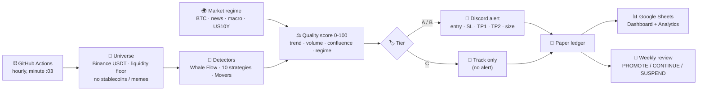

<div align="center">

<a href="https://github.com/shayansaeed25/DeepPocket-Tracker">
  
</a>

<a href="https://github.com/shayansaeed25/DeepPocket-Tracker">
  
</a>

<br/>

[](https://www.python.org/)
[](.github/workflows/scan.yml)
[](https://discord.com/)
[](SETUP_NEW_SHEET.md)
[](#-data-sources)
[](#-honest-by-design)

[**Overview**](#-overview) •
[**How it works**](#-how-it-works) •
[**Signal engine**](#-signal-engine) •
[**Risk**](#-risk-management) •
[**Setup**](#-setup-5-minutes) •
[**Config**](#-configuration) •
[**Reports**](#-dashboard--reports)

</div>

---

## ✨ Overview

**DeepPocket Tracker** is a free, fully automated crypto screener. Every hour it scans liquid **Binance USDT pairs** for signs of **institutional / whale activity**, both **accumulation (BUY)** and **distribution (SELL)**. It then grades each setup, attaches a stop-loss and take-profits, posts it to **Discord**, and tracks every signal as a **paper trade** in **Google Sheets** until TP or SL is hit.

- 🆓 **Zero cost:** runs on GitHub's free Actions scheduler. No server, no laptop left on.
- 🔑 **No exchange key needed:** uses public market data only.
- 🛑 **No live orders, ever:** it is a screener and tracker, not a trading bot.
- 📈 **Evidence-driven:** every strategy runs as a forward test and is promoted or suspended by statistics, not by feeling.

---

## 🧠 What it watches

| Layer | What it does |
|---|---|
| 🐋 **Whale Flow** | On-chain DEX swap imbalance for the top-16 assets (BTC, ETH, BNB, XRP, SOL, ADA, DOGE, TRX, TON, AVAX, LINK, DOT, LTC, BCH, UNI, ATOM). |
| 📊 **10 indicator strategies** | Donchian, RSI, WMA, DEMA, VWMA and momentum rules, evaluated on 1H and 4H and merged into one consensus signal. |
| 🚀 **Movers** | Top-gainer BUY pullbacks and top-loser SELL rallies, plus an institutional-style order-block retest. |
| 🌍 **Market regime** | A daily -100…+100 score from BTC momentum, news, macro, US 10Y yield, sentiment and flows. |
| 📰 **News monitor** | Listings, delistings, hacks, regulation, ETF flows and macro headlines for tracked coins, every 30 minutes. |

---

## ⚙️ How it works



1. **Scan** closed candles shortly after the 1H candle closes.
2. **Detect** setups with several independent detectors.
3. **Grade** each setup with a quality score and a tier.
4. **Gate** it through risk limits and circuit breakers.
5. **Alert + track** it: Discord message, paper position, Sheets row.
6. **Review** every week: strategies are promoted or suspended from net expectancy, profit factor and a t-statistic.

---

## 🎯 Signal engine

### Every candle is checked both ways

| | LONG | SHORT |
|---|---|---|
| Candle | bullish | bearish |
| Bollinger midline | price above | price below |
| EMA 9 / 21 | EMA9 > EMA21 | EMA9 < EMA21 |
| RSI | rising through bullish zone | falling through bearish zone |
| Stop-loss | tighter of ATR stop or recent swing low | tighter of ATR stop or recent swing high |

SHORT signals are tagged **"Futures only"** because spot cannot short.

### Quality score (0-100)

| Component | Weight | Meaning |
|---|---:|---|
| Trend | 30 | 4H and 1D agree with the trade direction |
| Volume | 25 | Volume expansion on the signal candle (or net flow imbalance) |
| Confluence | 25 | Number of **independent indicator families** agreeing, not raw rule names |
| Regime | 20 | BTC / market backdrop for this direction |

Plus session intelligence (London, London-NY overlap and US sessions get a boost; the Asia dead-zone is penalised) and order-flow context (relative strength vs BTC, taker-buy CVD, open interest and funding).

> **Why "independent families"?** WMA, DEMA and VWMA are all moving averages. Three of them agreeing is **one** opinion, not three.

### Tiers

| Tier | Meaning | Suggested size |
|:---:|---|---|
| 🥇 **A** | High score, 2+ independent families, trend aligned, regime not against | 1% risk (full) |
| 🥈 **B** | Solid score | 0.5% risk (half) |
| 🥉 **C** | Weak or counter-trend | Tracked only, no alert |

### Extra confirmation layers

These enrich a confirmed signal and never weaken the core logic.

- **Open interest:** rising OI upgrades the signal to *Very High*, confirming real derivatives positioning.
- **Funding rate:** shown as crowding context (Binance futures with Bybit and OKX fallbacks).
- **Multi-timeframe confluence:** flagged when the same direction confirms on 2+ timeframes.
- **On-chain DEX flow:** needs at least 20 swaps, $100k volume and a 20% buy/sell imbalance in a pool with $2M+ liquidity.

---

## 🛡️ Risk management

| Control | Behavior |
|---|---|
| **Stop-loss** | ATR-based or structure-based, passed through a stop-size gate (too tight = noise, too wide = rejected). |
| **TP1** | Equal to the stop distance, clamped to **$2-$5** on a $100 paper position. |
| **TP2** | 2.5× TP1. |
| **Break-even** | At TP1, 50% is booked and the stop moves to entry. A later entry touch is recorded as `BE_HIT`, not a loss. |
| **Ratchet** | If price runs 55% of the way from TP1 to TP2, the stop locks at TP1. |
| **Position size** | 1% of equity per trade (Tier A), 0.5% (Tier B). |
| **Portfolio limits** | Max 5 open live positions, 5% total open risk, 3% same-direction risk. |
| **Circuit breakers** | 3 stop-outs in a row pause live signals for 2h. -3R in one UTC day halts them until 00:00 UTC. |
| **BTC regime guard** | New BUYs are blocked when BTC momentum is strongly bearish, and new SELLs when strongly bullish. |
| **Cooldown** | The same coin cannot re-alert within 6 hours. |
| **Costs** | Paper P&L is also reported net of fees (0.10%/side) and slippage (0.05%/side), in R-multiples. |

---

## 🧪 Honest by design

This project is built to **avoid fooling itself**.

- ✅ **Nothing is LIVE by default.** All strategies run as **WATCH ONLY** paper forward tests until the weekly review says **PROMOTE**.
- ✅ **No verdict under 30 closed trades.** Below that, the report says `INSUFFICIENT DATA`.
- ✅ **Promotion needs evidence:** positive net expectancy, profit factor ≥ 1.3 and a t-statistic, with Wilson 95% win-rate intervals.
- ✅ **Claims are audited.** The strategy audit found database win rates of roughly 33%-76% on BTC/USDT, **not** "90%", and the docs say so.
- ✅ **Whale metrics are proxies.** Taker flow and DEX swaps do not prove who is buying.
- ✅ **Paper P&L is an estimate.** It uses candle price touches, not exchange fills, and excludes funding and real execution.

See [`STRATEGY_AUDIT.md`](STRATEGY_AUDIT.md) and [`INSTITUTIONAL_REVIEW.md`](INSTITUTIONAL_REVIEW.md) for the full analysis.

---

## 🚀 Setup (5 minutes)

### 1. Get the code

Fork or upload this repository to your GitHub account. Keep the folder structure exactly as-is, because `.github/workflows/scan.yml` must stay at that path.

### 2. Add GitHub secrets

**Settings → Secrets and variables → Actions → New repository secret**

| Secret | Required | Purpose |
|---|:---:|---|
| `DISCORD_WEBHOOK_URL` | ✅ | Signal, TP/SL and report alerts |
| `COINGECKO_DEMO_API_KEY` | optional | Free on-chain DEX flow (about 4,320 calls/month, within the 10,000 free quota) |
| `GOOGLE_SHEETS_SPREADSHEET_ID` | optional | Dashboard sheet |
| `GOOGLE_SERVICE_ACCOUNT_JSON` | optional | Sheets access (share the sheet with its `client_email` as **Editor**) |

> Without Google Sheets the bot still runs and writes a local `deep_pocket_log.csv`.

### 3. Enable and test

1. Open the **Actions** tab and click *"I understand my workflows, enable them"*.
2. Choose **DeepPocket Tracker Scan → Run workflow**.
3. After 1-2 minutes, check the logs and your Discord channel.

Full Google Sheets walkthrough: [`SETUP_NEW_SHEET.md`](SETUP_NEW_SHEET.md).

### Run locally

```bash
git clone https://github.com/shayansaeed25/DeepPocket-Tracker.git
cd DeepPocket-Tracker
pip install -r requirements.txt

export DISCORD_WEBHOOK_URL="https://discord.com/api/webhooks/..."
python src/screener.py            # run one scan
python src/strategy_stats.py      # build the strategy performance report
python -m unittest discover -s tests   # run the tests
```

---

## 🤖 Automation

| Workflow | Schedule | What it does |
|---|---|---|
| **DeepPocket Tracker Scan** | Hourly at `:03` | Scans, alerts, tracks TP/SL, syncs Sheets, saves state. |
| **DeepPocket Tracker News Watch** | Every 30 min (`:15`, `:45`) | Major headlines for tracked coins. |
| **DeepPocket Weekly Strategy Review** | Mondays 00:10 UTC | Writes `reports/strategy_performance.md/.csv`. |

State is committed back to the repo after every run, with each file staged separately and pushes retried, so cooldowns and open positions survive between runs.

---

## 🎛️ Configuration

Main knobs live at the top of `src/screener.py`:

| Setting | Controls |
|---|---|
| `VOLUME_SPIKE_MULTIPLIER` | How unusual volume must be to count as a spike |
| `SCAN_TIMEFRAMES` | Timeframes checked per coin (default `1h`, `4h`) |
| `STOP_LOSS_ATR_MULTIPLIER` | Stop distance in ATR units |
| `SIGNAL_COOLDOWN_HOURS` | Minimum time between alerts on the same coin |
| `ONLY_ALERT_TIER_AB` | Send only Tier A/B to Discord (Tier C is still tracked) |
| `ENABLE_OI_CONFIRMATION` / `ENABLE_FUNDING_RATE` | Derivatives context |
| `ALWAYS_SEND_SCAN_SUMMARY` | Post a "scan complete" report even with 0 signals |

Other files: `src/strategy_policy.py` (which strategies are live or watch-only), `src/risk_manager.py` (**set `ACCOUNT_EQUITY_USD` to your real equity**), `src/trade_tracker.py` (TP policy, fees), `src/quality_gate.py` (stop caps, BTC guard).

---

## 📊 Dashboard & reports

- **Google Sheets:** `Positions` and `Dashboard` visible. `Signals`, `Backtesting` and `System Health` hidden but active. The `Analytics` tab has a strategy evaluation table and 3 native charts (P&L by strategy, outcome donut, TP1 vs SL).
- **Daily Top-5 board:** the best-ranked setups at 06:00, 12:00 and 18:00 UTC. It never invents trades to hit a quota.
- **Weekly report:** win rate with confidence intervals, profit factor, expectancy in R, tier effectiveness, a net-P&L-per-day reality check and exit diagnostics.

---

## 📡 Data sources

| Data | Source |
|---|---|
| Candles, volume, taker flow, order book | Binance public market data |
| Funding and open interest | Binance Futures with Bybit / OKX fallbacks |
| Coin quality allow-list (top market-cap, no memes) | CoinGecko public API |
| On-chain DEX swaps | CoinGecko Demo (GeckoTerminal) |
| Macro: S&P 500, DXY, VIX, US 10Y | Yahoo Finance (FRED fallback) |
| Sentiment and global market | Fear & Greed, CoinGecko |
| News | CoinDesk, Cointelegraph, Decrypt, The Block, Google News RSS |

---

## 🗂️ Project structure

```text
DeepPocket-Tracker/
├── src/
│   ├── screener.py            # Main hourly scan + config
│   ├── strategy_scanner.py    # The 10 indicator strategies
│   ├── strategy_policy.py     # Live vs watch-only rules
│   ├── smart_money.py         # Order-flow / liquidity-sweep detectors
│   ├── dex_onchain.py         # On-chain DEX flow
│   ├── movers_strategy.py     # Gainers / losers strategies
│   ├── market_regime.py       # BTC / market regime score
│   ├── signal_quality.py      # Quality score + sessions
│   ├── tiering.py             # A / B / C tiers
│   ├── quality_gate.py        # Stop caps, BTC guard
│   ├── risk_manager.py        # Sizing + circuit breakers
│   ├── trade_tracker.py       # TP/SL tracking, paper accounting
│   ├── google_sheets.py       # Dashboard sync
│   ├── daily_board.py         # Daily Top-5 board
│   ├── strategy_stats.py      # Weekly statistics
│   └── news_monitor.py        # News alerts
├── strategies/                # Strategy profiles + source references
├── reports/                   # Weekly performance reports
├── tests/                     # Unit tests
└── .github/workflows/         # scan · news · weekly review
```

---

## ⚠️ Risk disclaimer

DeepPocket Tracker is a **screening and research tool**, not financial advice. Signals can be wrong, volume can come from non-institutional activity, and paper results exclude real fills, funding and slippage. Past or simulated performance does not predict future results. Never risk money you cannot afford to lose, and always confirm a setup yourself, especially on futures.

---

## 🤝 Contributing

Issues and pull requests are welcome, whether it's detectors, data sources, risk logic or reporting. New strategies should be added as **versioned forward tests**.

## 📄 License

See the `LICENSE` file in this repository.

<div align="center">

**Built by [Shayan Saeed](https://github.com/shayansaeed25)**

⭐ If this project helps your research, consider giving it a star.


</div>